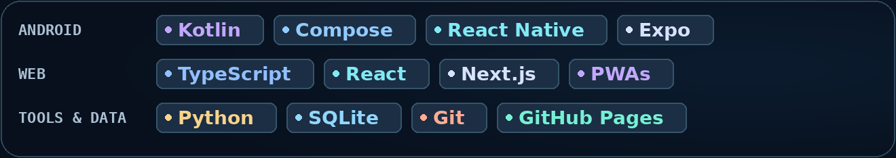
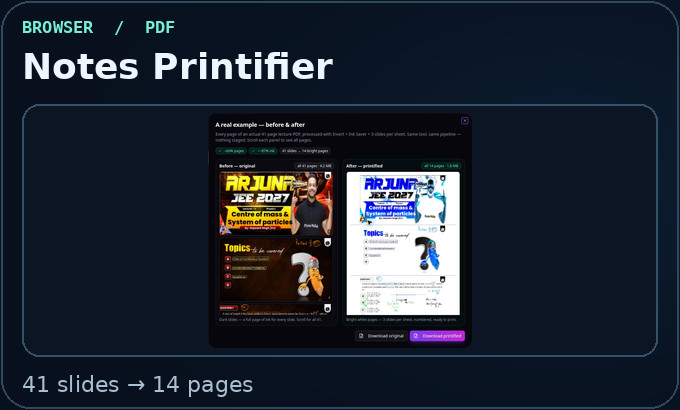
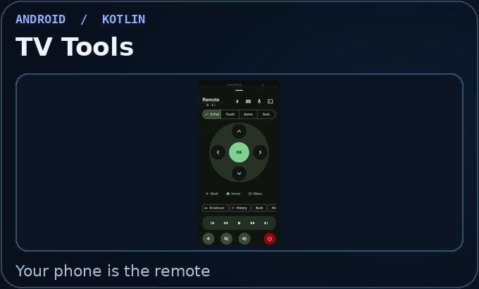
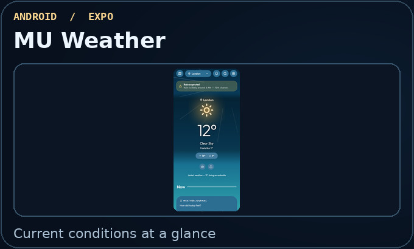
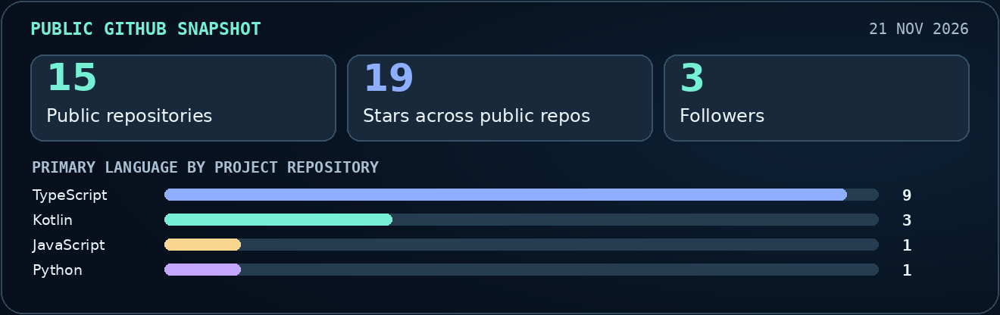

  
  <picture>
    <source media="(prefers-reduced-motion: reduce)" srcset="./profile-typing.png" />
    
  </picture>

  
<strong><a href="#about-me">About</a> · <a href="#tech-stack">Tech stack</a> · <a href="#featured-projects">Projects</a> · <a href="#github-analytics">GitHub activity</a></strong>

## About me

I’m Arnav. I build Android apps and browser tools for everyday problems: printing lecture notes, controlling an Android TV, browsing exported chats, and keeping important files close at hand.

| What I build | What that looks like |
| :--- | :--- |
| **Android apps** | TV controls, forecasts and widgets, and an offline vault |
| **Browser tools** | Lecture handouts, WhatsApp export browsing, and goal tracking |
| **What I care about** | Clear interfaces, offline workflows, and keeping users in control of their files |

## Tech stack

## Featured projects

### Notes Printifier

Turn a lecture deck into a print-ready handout in your browser. The real example goes from **41 slides to 14 printable pages**, with three slides per sheet.

  

  <strong><a href="https://avithegod2010.github.io/Notes-printifier/">Open website ↗</a> · <a href="https://github.com/Avithegod2010/Notes-printifier#the-41-to-14-page-example">See an example</a> · <a href="https://github.com/Avithegod2010/Notes-printifier/blob/stable/public/sample-printified.pdf">View finished PDF</a></strong>

### Android showcase

  
  

### Project index

| Project | What it does | Open |
| :--- | :--- | :--- |
| **TV Tools** | Control an Android TV, manage apps, and transfer files over Wi-Fi. | [Repository](https://github.com/Avithegod2010/TV-Tools) |
| **MU Weather** | Check current conditions, hourly forecasts, and Android home-screen widgets. | [Website](https://avithegod2010.github.io/MU-Weather/) · [Repository](https://github.com/Avithegod2010/MU-Weather) |
| **WA Archiver** | Browse exported WhatsApp chats, play voice notes, and explore chat stats on your device. | [Demo](https://avithegod2010.github.io/WA-archiver/app/) · [Repository](https://github.com/Avithegod2010/WA-archiver) |
| **Locker** | Keep passwords, notes, photos, and documents in an offline Android vault. | [Repository](https://github.com/Avithegod2010/locker) |
| **GoalCheck** | Plan goals, track habits, and focus with a timer that works offline. | [Web app](https://avithegod2010.github.io/Goalcheck/) · [Repository](https://github.com/Avithegod2010/Goalcheck) |
| **Wrong Way Rider** | Dodge oncoming traffic and chain near misses in a browser arcade game. | [Play](https://avithegod2010.github.io/Late-runner/) · [Repository](https://github.com/Avithegod2010/Late-runner) |

## GitHub analytics

Snapshot from 21 November 2026. The repository count includes this profile README repository. The language breakdown counts each project once, using GitHub’s primary language.

<strong><a href="https://github.com/Avithegod2010#js-contribution-activity">See live contribution activity ↗</a></strong>

## Connect and collaborate

Have an idea, found a bug, or tried a project? Open an issue in its repository so we can discuss it where others can follow along.

  <strong><a href="https://github.com/Avithegod2010?tab=repositories">Browse all projects</a> · <a href="https://github.com/Avithegod2010?tab=followers">Find me on GitHub</a></strong>

